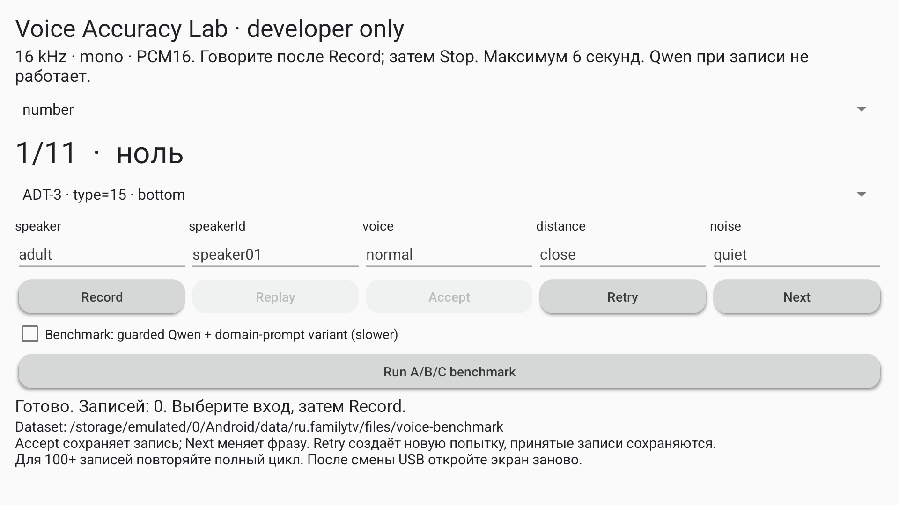

# Voice Accuracy Lab — Milestone 3.1

## Scope and architecture

The lab lives entirely in `app/src/debug/` and is absent from release builds.
It adds no game and does not change Math/Color ASR, Qwen prompt, prefix caching,
CPU strategy or recognition settings. `VoiceRuntime.reserveForDiagnostics` is
the only production-code change: it revokes foreground voice ownership, waits
for old native workers to close, and blocks prewarm until diagnostic resources
are closed. Leaving the lab cancels recording/benchmark at safe worker boundaries;
returning to games can require cold prewarm.

- `AccuracyLabActivity`: developer recording UI, audio-route selection, metadata,
  replay and explicit sample acceptance. No Qwen is loaded or run while recording.
- `AccuracyDataset` / `WaveFiles`: strict JSONL and chunk-aware RIFF validation.
- `AccuracyDomain` / `AnswerPolicy`: fixed domain vocabularies and conservative
  semantic output checks, independent of reference answers.
- `AccuracyRunner`: VAD → current Russian small Zipformer → optional Qwen;
  serial native ownership. One ASR recognizer at a time, reused for the corpus;
  every recognizer is released before the next configuration. Qwen runs afterward.
- `AccuracyMetrics`: WER/edit counts, grouped summaries, JSON/CSV/Markdown.
- `tools/voice_accuracy_lab.py`: adb-only recording launch, frozen-corpus transfer,
  benchmark invocation and report retrieval.

## Dataset format

```text
voice-benchmark/
  manifest.jsonl
  audio/sample_0001.wav
  runs/<run-id>/{results.json,results.csv,summary.json,summary.md}
```

Each JSONL line describes one accepted recording:

```json
{"id":"sample_0001","file":"audio/sample_0001.wav","truth":"шесть","category":"number","domain":"NUMBER_0_10","allowed":["ноль","один","два","три","четыре","пять","шесть","семь","восемь","девять","десять"],"answerTruth":"6","speaker":"adult","speakerId":"speaker01","voice":"normal","distance":"close","noise":"quiet","microphone":"h340"}
```

Required: `id`, relative `file`, spoken transcript `truth`, `category`.
Supported standard categories: `number`, `color`, `yes-no`, `phrase`; additional
control categories are allowed. `domain` defaults from the first three
categories; use an explicit domain for phrases. `OPEN` has no vocabulary and
semantic normalization abstains. Optional `allowed` must equal the **entire**
fixed domain vocabulary, including no duplicates; it never feeds the decoder.
Hotwords are built from the domain enum, never from manifest truth.

`answerTruth` is a scoring-only canonical label: number digits 0–10, one of four
colors, да/нет, or `UNKNOWN`. Single-word labels can be derived from an exact
lexical match; phrase labels should be provided explicitly. A missing semantic
label is excluded from semantic accuracy, not guessed by Qwen. `truth` always
remains the full transcript for raw ASR scoring. Empty truth is allowed for
negative silence controls. IDs must be unique and paths cannot escape the root.

Metadata is extensible: `speaker` adult/child/unknown; stable pseudonymous
`speakerId`; `voice` normal/quiet/whisper; `distance` close/1m/2m; `noise`
quiet/room/playback; `microphone` h340/xvf3800/other. The recorder also captures
route name/type/address, timestamp, sample format, peak, RMS, clipping fraction
and audio SHA-256. Do not put personal names into speaker IDs.

WAV must be uncompressed 16 kHz mono PCM16, nonempty, at most 30 seconds. Header,
chunk sizes, sample rate, byte rate, alignment and channel count are validated.
Non-audio RIFF chunks are permitted. Input files are never silently resampled.

## Collect recordings

Install the debug APK, then:

```sh
python3 tools/voice_accuracy_lab.py --serial 192.168.68.109:5555 record
# Equivalent:
adb shell am start -n ru.familytv/.accuracy.AccuracyLabActivity
```

1. Connect the intended microphone. Select its **actual input route** in the
   spinner. USB inputs are listed first. Set speaker ID and conditions.
2. Choose number/color/yes-no/phrase. Read the displayed prompt. There are **26**
   definitions in `app/src/debug/assets/accuracy/phrases.json`: 11 numbers,
   4 colors, 2 yes/no words and the 9 requested phrases.
3. Press **Record**, pause briefly, speak, leave ~0.7 seconds of silence, then
   **Stop**; recording automatically stops at 6 seconds. Route mismatch,
   disconnect and too-short capture are rejected. Check peak/RMS.
4. **Replay** the draft. **Accept** writes a uniquely named WAV and atomically
   replaces the manifest with the appended row. Acceptance is explicit;
   Next alone never saves. Zero-PCM recordings cannot be accepted.
5. **Retry** makes another attempt at the same phrase; already accepted recordings
   are retained. **Next** moves through the selected category, wrapping at its end.
   Four complete 26-prompt repetitions produce 104 labeled files.

Replay uses Android's current output route; the headset output may be selected.
Reopen the screen after changing USB devices to refresh the input list. Grant
RECORD_AUDIO when prompted; if permanently denied, enable it in Android settings.
Leaving the screen stops recording and prevents unaccepted drafts being added.
An interrupted save may leave an orphan WAV, which is ignored because runners read
only manifest entries. Never edit the manifest while a run or acceptance is active.

Pull to a **new**, ignored directory before uninstalling/clearing app data:

```sh
python3 tools/voice_accuracy_lab.py --serial 192.168.68.109:5555 pull voice-benchmark/local-h340-v1
```

## Run the experiment matrix

```sh
./gradlew assembleDebug :app:assembleDebugAndroidTest :app:testDebugUnitTest :app:lintDebug
adb install -r app/build/outputs/apk/debug/app-debug.apk
adb install -r app/build/outputs/apk/androidTest/debug/app-debug-androidTest.apk
python3 tools/voice_accuracy_lab.py --serial 192.168.68.109:5555 run --output voice-benchmark/runs/asr-v1
python3 tools/voice_accuracy_lab.py --serial 192.168.68.109:5555 run --qwen --output voice-benchmark/runs/asr-qwen-v1
```

The on-screen **Run A/B/C benchmark** uses the same runner; its Qwen checkbox
adds both semantic variants. Runs do not record audio. Empty corpora produce
explicit empty reports, not an accuracy percentage. CLI output directories must
be new, and failed instrumentation is reported even when adb returns exit code 0.

| ID | Decoding | Context score |
|---|---|---:|
| A_greedy | greedy_search | none |
| B_beam | modified_beam_search | none |
| C_hotwords_0.5 | modified_beam_search | 0.5 |
| C_hotwords_1.0 | modified_beam_search | 1.0 |
| C_hotwords_1.5 | modified_beam_search | 1.5 |
| C_hotwords_2.0 | modified_beam_search | 2.0 |

All use CPU, four ASR threads, four active beam paths and blank penalty 0.
Numbers use all eleven words, colors all four, yes/no both. Phrases use their
explicit domain. There is no hotword file containing reference answers.

VAD uses the production Silero parameters: threshold 0.5, minimum speech 250 ms,
minimum silence 500 ms, 512-sample blocks, maximum speech 30 s. Every WAV is
followed by the same 1 s synthetic EOF silence; `flush()` is never called.
Every completed segment is decoded; transcripts are joined in chronological
order. No endpoint produces empty STT and semantic UNKNOWN. No VAD parameter is
changed in the games. The fixture tests verify real VAD endpoints separately
from the human corpus.

## Hotword and confidence investigation

The checked-in Kotlin wrapper exposes `decodingMethod`, `maxActivePaths`,
`hotwordsScore`, `modelingUnit`, `bpeVocab` and `createStream(hotwords)`.
The native binary contains version string **1.13.6**; its exact SHA-256 is stored
in every run. In the matching upstream implementation, `/` separates per-stream
hotword phrases and BPE encoding uses `modelingUnit="bpe"` plus `bpeVocab`.
Hotwords require a transducer with modified beam search.
[Official hotword documentation](https://k2-fsa.github.io/sherpa/onnx/hotwords/index.html).

The vocabulary was copied from the existing local Firefly model integration.
All 500 BPE pieces match this model's token IDs; the model tokens file additionally
contains disambiguation symbols `#0` and `#1`. No vocabulary was reconstructed from
word guesses. BPE SHA-256:
`52649881bb41fafe4257c74d77a85320524494a9d8c48e93d4aaa216cc45113d`.

`OfflineRecognizerResult` in this checkout exposes text, tokens, timestamps,
language/emotion/event and TDT durations. It exposes **no token probabilities,
beam scores or N-best**. Upstream 1.13.6 C++ has a `ys_log_probs` result member,
but the checked-in Kotlin/JNI mapping does not return it. We did not replace the
native binary or invent a confidence score. Token timestamps are recorded as
segment-relative timing information, not confidence.
[Versioned transducer source](https://github.com/k2-fsa/sherpa-onnx/blob/v1.13.6/sherpa-onnx/csrc/offline-recognizer-transducer-impl.h),
[JNI mapping](https://github.com/k2-fsa/sherpa-onnx/blob/v1.13.6/sherpa-onnx/jni/offline-recognizer.cc).

## Conservative semantic experiments

`AnswerRecognitionResult` is either `Recognized(value, info, confidence=null)`
or `Unknown(reason)`. A literal baseline accepts canonical words/numbers and the
explicit narrow truncation `пят → 5`. This is a separately testable lexical rule,
not acoustic confidence. No `честь → шесть`, `сыны → синий` or phonetic nearest
neighbor table is introduced.

With Qwen enabled, two isolated variants are reported:

- **Guarded Qwen:** the unchanged production prefix, with whole-domain admission
  and output validation around it. Input remains the STT transcript only.
- **Domain Qwen:** an experimental cached domain instruction listing the entire
  answer type/value set, explicitly allowing `UNKNOWN`. Each domain prefix is
  cached once per group; model weights/context are reused. This simpler prefix
  is an experiment, not a candidate automatically deployed to games.

Both skip Qwen when STT contains no lexical domain evidence. Output must be in
the domain **and supported by a token in the transcript**, or becomes UNKNOWN.
Thus `ты → 2`, `честь → зелёный`, and `четыре → 5` are rejected. Recognition errors
that already resemble a valid domain word remain possible: no acoustic score is
available to distinguish them. Mixed corrections containing multiple valid
answers still depend on semantic extraction; the benchmark must judge accuracy.
Reference truth/answerTruth are never arguments to ASR or Qwen methods.

## Metrics and interpretation

Reports preserve original truth/raw strings. Exact comparison and WER use
lowercase, trim/collapsed whitespace and common punctuation removal; **ё and е
remain distinct**. `results.json` is authoritative. CSV quotes cells and protects
formula-leading text for spreadsheet import.

- Raw exact = identical canonicalized full transcripts / all samples. A is the
  current baseline; B/C measure alternative/contextual ASR on the same samples.
- WER = total word substitutions + deletions + insertions divided by total
  reference words (micro-average). Empty references contribute insertions but
  no denominator; an all-empty group has undefined WER.
- Semantic accuracy separately compares literal, guarded-Qwen and domain-Qwen
  values against labeled `answerTruth`. UNKNOWN is abstention, not a hidden
  substitution. Unknown rate and false accepted answers are reported; negative
  controls should be explicitly labeled UNKNOWN.
- STT time covers stream creation, feature ingestion, native decoding and result
  extraction for all VAD segments. RTF = STT milliseconds / original WAV duration.
  VAD CPU time and Qwen wall time are separate. EOF padding is not added to the
  RTF denominator. These are offline replay timings, not live end-to-answer delay.
- Median uses the middle value/mean of two; p95 uses nearest rank. ASR summaries
  include the first decode; `asrFirstAfterInit` identifies it. Model initialization
  and prefix preparation are separate costs. Qwen latency excludes skipped calls.
- Groups include category, single-number, single-color, full phrases/controls,
  and microphone/speaker/voice/distance/noise metadata. Common substitutions are
  whole truth→STT pairs; S/D/I are word-level edit counts.

Every run records manifest/audio/model/native hashes, device/Android identifiers,
configuration order, VAD parameters, initialization times and policy version.
A cancelled run contains partial results and `cancelled=true`; never compare it
as a complete paired experiment. Native exceptions are explicit failed rows.
Malformed datasets fail preflight. Run configurations in the fixed recorded
order; repeat trials to check thermal/order sensitivity before a latency claim.

## Comparing H340 and XVF3800

1. Freeze phrase definitions, reference labels and ASR settings. Use the same
   H728 and app build. Keep a tuning set separate from held-out evaluation.
2. Record the same speakers and repetitions on each microphone with matched
   voice, distance and noise. Alternate microphone order across blocks to reduce
   fatigue/order effects. H340 is a headset: report its mouth geometry separately;
   do not call a close headset vs 2 m array result a matched microphone comparison.
3. Assign stable speaker IDs and annotate microphone/conditions accurately. Keep
   recordings paired by phrase + speaker + repetition (add `repetition` metadata
   when assembling the frozen dataset). Include quiet speech, short words and
   unknown/silence/out-of-domain controls, not only fluent prompted phrases.
4. Pull each corpus to a separate new directory, inspect WAV playback/labels,
   freeze its hashes, and never relabel a failed decode to match the model.
5. Upload a frozen corpus with `push SOURCE --name frozen-h340-v1`; use the printed
   path with `run --dataset PATH --qwen --output NEW_DIRECTORY`. Run **the exact
   same six configurations** on both frozen corpora on the same H728.
6. Compare raw/contextual/semantic accuracies separately, first for single numbers
   and colors, then full phrases. Compare false accepts, UNKNOWN and WER S/D/I;
   inspect paired failures. Choose the score on the tuning set, verify on held-out
   speakers/recordings, and only then compare latency median/p95 and RTF.
7. Do not promote a setting merely because it scored best on a tiny corpus or
   has the largest hotword score. Document held-out gains and regressions, then
   make an explicit later production change. **No winner is selected in 3.1.**

## Validation and corpus status

Human labeled corpus: **0 recordings** at implementation time. The checked-in
manifest is empty. A pre-existing unlabelled `mic_test.wav` is not a benchmark
reference. The existing Russian literary fixture and synthetic silence are
mechanical smoke controls only; their results must not be presented as short
Russian answer accuracy or microphone comparisons.

Run core tests with `:app:testDebugUnitTest`. Device tests:

```sh
adb shell am instrument -w -e class ru.familytv.accuracy.AccuracyLabInstrumentedTest ru.familytv.test/androidx.test.runner.AndroidJUnitRunner
```

`benchmarkDataset` is skipped unless `-e accuracyDataset ABSOLUTE_PATH` is
provided; the CLI supplies it. The other tests exercise all six native ASR
configurations with number/color hotword streams plus silence, and real Qwen
variants with the conservative evidence gate. Device smoke outputs live under
app external files as `accuracy-smoke-results/` and
`accuracy-qwen-text-smoke.json`. They are explicitly not a human accuracy corpus.

### Preliminary text-only Qwen experiment

The native text smoke run tested five positive phrases across number/color
plus four no-evidence inputs, in each mode. The guarded original prefix retained
all five positive answers. The minimal domain-only prefix retained only one:
it emitted `UNKNOWN`, `NUMBER_0_10`, or an unstripped phrase for several inputs;
validation converted unsupported outputs to UNKNOWN. Both modes rejected
`честь` and `ты` before inference. These are **text-interface smoke observations**,
not audio accuracy rates. The domain-only candidate is known to underperform on
these examples and must not be promoted; it remains an explicit optional
benchmark variant. No per-word acoustic correction was added to compensate.

### Verified delivery on 15 September 2026

- `assembleDebug`, debug test APK assembly, all **15 JVM tests** (8 lab + 7 game)
  and `lintDebug` passed. Lint reported **0 errors, 89 warnings**. Release manifest
  generation confirmed AccuracyLabActivity is excluded.
- Real-device ASR smoke passed: 18 evaluations across all six configurations,
  using the same ~6.9 s literary recording under two domain contexts and a
  synthetic-silence control. Each configuration decoded the reference text and
  emitted nothing for silence. This does **not** estimate short-answer accuracy.
  No hotword-encoding failure was logged. Model initialization was ~11.1–11.3 s
  per isolated ASR configuration.
- Both Qwen text/gating variants ran on the real native model. The final text
  report explicitly marks `qwenInvoked=false` for pre-inference rejections rather
  than attributing the gate's UNKNOWN to the model. The domain-only candidate's
  poor positive-case results are documented above.
- The CLI was run against the actual empty device dataset: instrumentation passed,
  and JSON/CSV/Markdown reports correctly contain zero scored samples and no
  invented accuracy. The default dataset test is skipped in class-wide smoke
  runs unless a path is supplied; its parameterized empty-corpus invocation was
  tested separately.
- The existing **production** Qwen latency test also passed: **40/40 exact**,
  warm median **683.755 ms**, p95 **1117.229 ms**, max **1122.684 ms**. Prefix 162
  tokens, zero prefix tokens reevaluated, 14–22 new input tokens, four CPU threads.
  Production VAD/STT/Qwen source files match Git HEAD byte-for-byte.
- Debug APK installed on ADT-3/H728, Android 14. The recorder was launched and
  visually checked at 1920×1080. Record/automatic stop produced a 6000 ms WAV
  draft from the available ADT-3 input; its peak/RMS were zero. Accept rejected
  it, and the user manifest remained **0 lines**. H340 was not attached.
- The final ready recorder used ~104,120 KiB PSS (~102 MiB), with no AI stack
  loaded. It was left open for collection. No human speech, positive acoustic
  acceptance, or H340/XVF3800 comparison is claimed.



Local generated evidence is in `app/build/reports/voice-accuracy/`: `build.txt`,
`native-smoke.txt`, `smoke/`, `qwen-text-smoke.json`, `empty-dataset/`,
`production-qwen.json`, recorder UI snapshots and memory information. These
outputs may be removed by a clean build; retain/freeze results outside `build/`
when conducting the actual human study.

Important changed files: all five Kotlin files in
`app/src/debug/java/ru/familytv/accuracy/`, the debug manifest and two debug
assets (`phrases.json`, `bpe.vocab`); `AccuracyCoreTest` and
`AccuracyLabInstrumentedTest`; the diagnostic reservation in `VoiceRuntime.kt`;
`tools/voice_accuracy_lab.py`; `voice-benchmark/` template; this document and the
vocabulary hash file; Gradle test-only JSON dependency, `.gitignore`, and
`AGENTS.md`. No experimental settings were promoted to games.

## Public corpora and optional cloud references

See [VOICE_CLOUD_BENCHMARK.md](VOICE_CLOUD_BENCHMARK.md) for Milestone 3.2 imports, frozen subsets, cloud cost/privacy gates and comparison reports. Production games remain local. Use `run --corpus-kind public` for public datasets; private recordings remain private by default.
