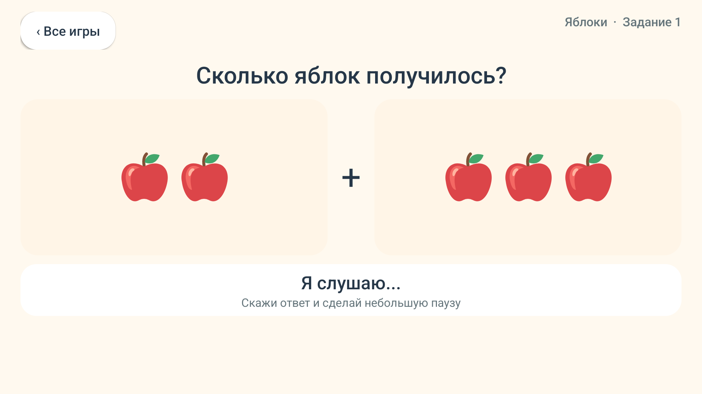
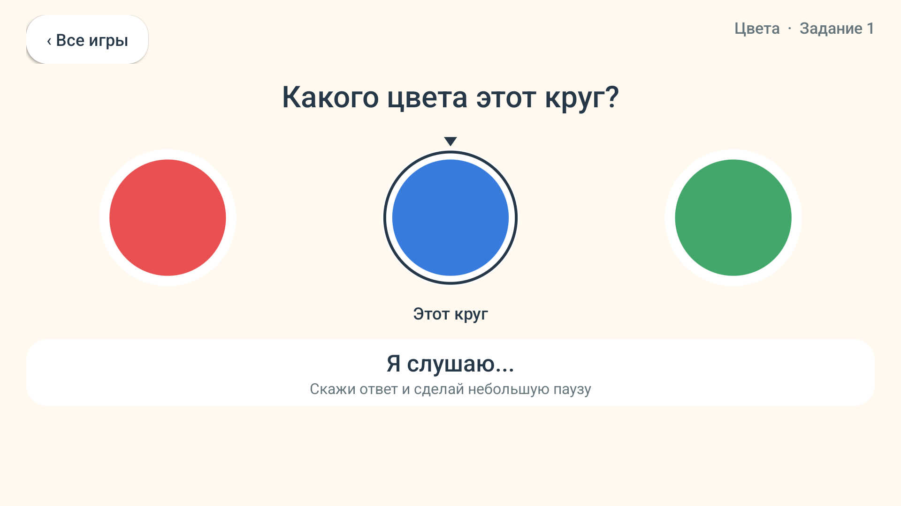
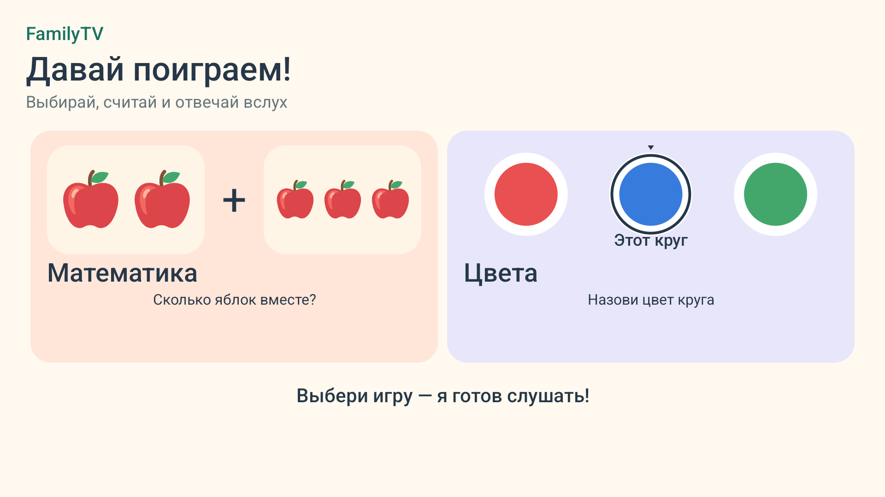

# Milestone 3 delivery report

Validation date: 14 September 2026. Device: ADT-3 / H728 (`sun55iw3p1`),
Android 14, arm64, adb `192.168.68.109:5555`. No human speaker was present.

## 1. Architecture implemented

A child-facing Game Hub launches Apple Addition and Color Choice. Both use the
same small game session controller and voice-answer interface. The original
VoiceLab remains available. [Architecture and operation](VOICE_GAMES.md).

## 2. Important files

All source paths below are relative to `app/src/main/java/ru/familytv/`.

| Added/changed | Purpose |
|---|---|
| `voice/VoiceAnswer.kt` | Domain states, metrics, answer and interface |
| `voice/VoiceRuntime.kt` | Process ownership, prewarm, exclusive leases, safe retry |
| `voice/VoiceAnswerPipeline.kt` | Foreground lifecycle and StateFlow adapter |
| `games/GameSession.kt` | Seeded questions and deterministic answer rules |
| `games/VoiceGameSessionController.kt` | Shared listening/feedback/retry state machine |
| `games/GameViews.kt` | Local apple/circle rendering and child UI styling |
| `games/GameHubActivity.kt` | New launcher and AI readiness |
| `games/BaseVoiceGameActivity.kt` | Shared screen plus Math/Color Activities |
| `voicelab/VoiceLabController.kt` | Single-answer option, typed errors, generation snapshots, asynchronous teardown |
| `voicelab/VoiceLabActivity.kt` | Reuses shared runtime; retains diagnostic controls |

Also changed: `app/src/main/AndroidManifest.xml`,
`app/src/main/res/drawable/game_apple.xml`, `app/build.gradle.kts`,
`gradle/libs.versions.toml`, `AGENTS.md`, and lifecycle pointers in
`docs/VOICE_LAB.md`, `docs/VOICE_LAB_QWEN.md`, `docs/QWEN_LATENCY.md`.
New JVM tests are `games/GameSessionTest.kt` and
`games/VoiceGameSessionControllerTest.kt` under `app/src/test/java/ru/familytv/`.
Device tests under `app/src/androidTest/java/ru/familytv/` add
`games/VoiceGamesInstrumentedTest.kt`, `voicelab/RuntimeTestSupport.kt`, and extend
the existing Qwen/latency/VoicePipeline tests. Screenshots are under
`docs/images/voice-games/`.

## 3. Reusable pipeline

`VoiceAnswerSource` exposes activation, start, stop, retry, close and StateFlow.
The only inference input is a transcript, originating in STT. A lease owns one
foreground session; generations reject old callbacks/results on screen changes.
Games stop capture at the first VAD endpoint and restart after feedback.

## 4. AI lifecycle / prewarm

Hub entry starts background model loading, with disabled cards and
“Подготовка игр...”. Measured shared cold loading was approximately 14–15 s.
One stack survives Hub → Math → Hub → Colors → VoiceLab; an instrumentation
assertion verifies the initialization count stays constant. A separate fault
injection verifies initialization retry frees the old Qwen handle before
replacement. Pause/Back stops recording; process lifetime retains the models.

## 5. Math screen

Two local vector apple groups, each 1–5, sum up to 10. The same problem remains
after wrong/unknown answers; correct advances after 1.5 s.

[Correct feedback](images/voice-games/math-correct.png) ·
[Wrong feedback](images/voice-games/math-wrong.png) ·
[Actual missing-microphone screen](images/voice-games/math-actual.png).

## 6. Color screen

Three colored circles; an arrow and dark outline mark the target. Four canonical
color names are accepted, with deterministic comparison in the game layer.

[Correct feedback](images/voice-games/color-correct.png) ·
[Actual missing-microphone screen](images/voice-games/color-actual.png) ·
[Hub](images/voice-games/hub.png) · [VoiceLab](images/voice-games/voice-lab.png).

Question/correct/wrong screenshots use instrumented presentation states. They
are not live speech results. Actual screenshots show the real disconnected
microphone state observed on the device. All were visually inspected at 1080p.

## 7. State machines

Voice: INITIALIZING → READY → LISTENING → SPEECH → STT_PROCESSING →
LLM_PROCESSING → RESULT, with explicit ERROR/STOPPED.
Game: LOADING → QUESTION → LISTENING → SPEECH → PROCESSING →
CORRECT/WRONG/NOT_UNDERSTOOD, plus ERROR/STOPPED. Lifecycle pause cancels timers
and unfinished input; manual error retry preserves the question.

## 8. Answer-key isolation proof

The voice interface has no question or expected-answer parameter. Only
`GameQuestion`, `AnswerJudge` and game telemetry reference `expectedAnswer`.
The unchanged prompt/JNI receive transcript text only. A real Qwen test sends
“сколько будет два плюс три мой ответ четыре”, asserts `4`, then asserts
`AnswerJudge(2+3, 4) == WRONG`. Thus model normalization cannot silently substitute
`5`. SHA-256 comparison with the pre-change snapshot confirmed `VoiceEngine.kt`,
`family_qwen.cpp` and `AnswerPrompt.kt` are unchanged.

## 9. Test results

| Suite | Result |
|---|---|
| GameSession JVM | 4/4 passed |
| Shared session controller JVM | 3/3 passed |
| VoiceGames device | 2/2 passed |
| QwenAnswer device | 2/2 passed, 40/40 exact corpus outputs |
| VoicePipeline device | 2/2 passed |
| QwenLatency device | 1/1 passed, 40/40 exact corpus outputs |

Qwen tests retain numeric correction, “не знаю”, arithmetic trap, queued/in-flight
cancellation and affinity restoration; added cases cover “я игра синий” and all
four colors. Game tests verify shared ownership, stale-result rejection and
controlled microphone/initialization failures. The first UI test run exposed a
test teardown race; waiting for the Activity's lease release fixed it, and the
complete suite passed on rerun.

The prerecorded Russian VAD/STT fixture produced the exact expected text twice
with real endpoints (no forced flush), STT 824/681 ms for a ~6.9 s sentence.
Microphone Start/Stop/restart/clear/background checks passed. These are not live
child speech measurements.

## 10. Qwen benchmark

With the existing AudioRecord/VAD capture loop active: **40/40 exact**,
39 warm requests after excluding the first request:

| Metric | Measured |
|---|---:|
| Warm median | 693.311 ms |
| Warm p95, nearest rank | 1120.354 ms |
| Warm maximum | 1122.166 ms |
| First request after prewarm | 808.069 ms |
| Constant cached prefix | 162 tokens |
| Prefix tokens reevaluated per request | 0 |
| New user tokens | 14–22 |
| Output tokens | 1–5 |

Gate median <1200 ms and p95 <1500 ms passed. The original 14-case subset has
warm median 670.482 ms / p95 764.512 ms (27 samples), matching the previous path;
the expanded color corpus contains longer, 4–5-token outputs. CPU strategy 2,
four prefill/generation threads and scoped CPU4–7 affinity remain active.
Temperature reached approximately 61.6°C during this run.

## 11. Build and lint

Final `assembleDebug`, `testDebugUnitTest`, `lintDebug`, and instrumented APK
assembly passed. Lint: **0 errors, 68 warnings**, including dependency update
notices, localization suggestions, Canvas allocations and the singleton context
warning. The singleton explicitly retains `applicationContext`, not Activities;
that context warning is a conservative lint finding. No broad dependency/native
upgrade was introduced.

Raw local outputs: `app/build/reports/voice-games/` contains build, suite logs,
Qwen logcat/JSON distributions, routing and memory snapshots. Generated reports
are not contributor source files. APK: `app/build/outputs/apk/debug/app-debug.apk`.

## 12. H728 installation and launches

Debug and instrumentation APKs installed successfully. Hub, Math, Colors and
VoiceLab launched without startup crashes; screenshots verify landscape layout
and child-safe text. The manifest now launches the hub; the legacy recorder
remains accessible explicitly. Final handoff observations are recorded below.

## 13. Memory and performance observations

There is one application-owned VAD/STT/Qwen stack. Model initialization count
is unchanged across games; only an explicit initialization-failure retry creates
a new stack, after native release. Models remain resident while idle by design.
The capture loop is off in the hub and on lifecycle pause. Current device memory
snapshot is recorded below; it is a point-in-time PSS observation, not a leak
stress test. Cold startup was intentionally not optimized further.

## 14. Known issues and validation limits

H340 was **not connected** during this validation. Diagnostic capture routed to
ADT-3 and returned zero PCM peak/RMS; games correctly blocked that input with
“Микрофон не подключён”. Actual physical unplug/replug, permission-denial UX and
live STT→Qwen→game answers remain manual acceptance items. Removal and model
failure recovery were injected in device tests; they are not a claim of physical
USB testing. The prior reported 1.5–1.9 s live latency was not remeasured tonight.

The prototype is Russian-only, has no persistence/scoring/TTS, and may repeat
random questions. Strict output validation rejects unsupported strings. Android
may reclaim an idle process, requiring cold prewarm again. Git history/status
were unavailable because this checkout is not recognized as a Git repository;
no commit or fabricated diff history is claimed.

## 15. Five-minute live acceptance

Follow the timed [five-minute checklist](VOICE_GAMES.md#five-minute-live-acceptance-tomorrow):
connect H340 and confirm its route; test wrong/unknown/correct Math answers;
switch to Colors without prewarm; test incorrect/correct colors; Back during
speech; physically unplug/replug and retry; inspect one live VoiceLab phrase.
The checklist requires a human speaker, so it was deliberately left unclaimed.

## Final handoff observation

After final installation, the APK was exercised through
actual hub card taps, the in-game “Все игры” button, Android Back, and debug
long-press entry to VoiceLab. It returned to the hub showing
“Выбери игру — я готов слушать!”. Logcat contained exactly one
`runtimeInitialization count=1`, no runtime reload and no AndroidRuntime crash.
No recording session was started by these games because H340 was absent.

Ready-hub PSS was 1,054,493 KiB before navigation and 1,056,691 KiB after
(~1.006–1.008 GiB); RSS after navigation was 1,148,496 KiB. The ~2.1 MiB PSS
change is consistent with UI allocation, not another model stack. Dumpsys
counted five Activity objects before a forced collection; this snapshot is not
proof of object collection or a long-duration leak test. The runtime's only
retained context is the application context. Final cold preparation measured
15,018 ms for Qwen and 14,374 ms for STT in parallel; the hub itself launched in
1,494 ms and remained responsive during prewarm.

